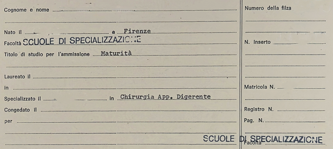

# LibrettiEx OCR

**Valutazione comparativa di modelli OCR e Vision-Language per la trascrizione di libretti universitari storici.**

*Project Work in Data Mining — Università degli Studi di Firenze.*

Il progetto analizza l'efficacia di modelli OCR e Vision-Language nella trascrizione automatica di documenti storici che combinano **testo prestampato, scrittura manoscritta e layout a più colonne**.

È stato costruito un dataset di **18 libretti universitari storici**, accompagnati da trascrizioni manuali di riferimento (*ground truth*). Sono stati confrontati quattro modelli Vision-Language generalisti (**Gemma 4, Qwen3-VL, Qwen3.5 e Nemotron 3**) e due modelli OCR specializzati (**GLM-OCR e DeepSeek-OCR**), eseguiti localmente tramite **Ollama**. La sperimentazione ha considerato differenti strategie di prompting e dimensioni della finestra di contesto.


<div>
  

  <pre>
Cognome e nome
Nato il a Firenze
Facoltà SCUOLE DI SPECIALIZZAZIONE
Titolo di studio per l'ammissione
Maturità
Laureato il
in
Specializzato il in
Chirurgia App. Digerente
Congedato il
per

Numero della filza
N. inserto
Matricola N.
Registro N.
Pag. N.
Facoltà SCUOLE DI SPECIALIZZAZIONE
  </pre>
</div>


La valutazione è articolata in due livelli:

- **Valutazione globale:** confronto delle trascrizioni complete mediante Character Error Rate (CER), Word Error Rate (WER) e Word F1 indipendente dall'ordine delle parole.
- **Analisi strutturata per campo:** estrazione e valutazione delle coppie chiave–valore tramite template noti, distinguendo campi `string`, `numeric` e `dictionary` e confrontando i risultati prima (PRE) e dopo (POST) un post-processing controllato.

La pipeline separa l'esecuzione OCR, la normalizzazione, il parsing strutturale e la valutazione. Il parser utilizza la struttura nota dei libretti senza consultare la ground truth per individuare i campi OCR.

## Risultati principali

### Valutazione globale della trascrizione

La tabella riporta le migliori configurazioni per ciascun modello generalista, utilizzando una **finestra di contesto di 8.192 token**. Le metriche sono calcolate sulle trascrizioni normalizzate, prima del post-processing.

| Modello | Prompt | CER ↓ | WER ↓ | Word F1 ↑ |
|---|---|---:|---:|---:|
| **Gemma 4 (31B)** | Completo | **1,57%** | **4,03%** | **96,46%** |
| Qwen3-VL (32B) | Essenziale | 2,79% | 5,73% | 95,43% |
| Qwen3.5 (27B) | Intermedio | 4,66% | 10,22% | 91,26% |
| Nemotron 3 (33B) | Completo | 18,63% | 25,18% | 84,26% |

**Gemma 4** ottiene i risultati migliori, seguito da **Qwen3-VL**, che raggiunge prestazioni vicine utilizzando il prompt essenziale.

I modelli OCR specializzati sono stati valutati separatamente e non sono inclusi nella graduatoria principale.

### Analisi strutturata per campo

L'analisi è stata condotta su **316 coppie chiave–valore**, distribuite in 155 campi `string`, 125 `numeric` e 36 `dictionary`, attraverso tre differenti template documentali.

| Modello | Chiavi individuate | Valori valutabili (PRE) |
|---|---:|---:|
| **Gemma 4** | **99,68%** | **99,37%** |
| Qwen3-VL | 99,68% | 99,37% |
| Qwen3.5 | 99,05% | 98,10% |
| Nemotron 3 | 86,39% | 77,22% |

Per **Gemma 4**, l'accuratezza esatta dei valori valutabili raggiunge:

- **92,74%** per i campi `numeric`;
- **84,42%** per i campi `string`;
- **94,44%** per i campi `dictionary` dopo il post-processing, rispetto all'88,89% iniziale.

Le percentuali di accuratezza dei valori sono calcolate sui soli campi valutabili.

Il post-processing sfrutta la conoscenza dei template per canonicalizzare le chiavi riconosciute e un dizionario esterno per correggere alcuni valori. Per Gemma 4, il **WER globale passa dal 4,03% al 3,76%**, mentre per Qwen3-VL passa dal **5,73% al 5,29%**.

## Riproducibilità

Il repository contiene il codice Python, i template YAML e il dizionario esterno necessari alla pipeline. Le immagini originali, le ground truth manuali, gli output OCR e i risultati sperimentali non sono inclusi.

**Requisiti:** Python 3.10+ (consigliato 3.12), [Ollama](https://ollama.com/) e le dipendenze definite in `requirements.txt` (`rapidfuzz`, `PyYAML`). Le risorse hardware dipendono dai modelli utilizzati.

I dati devono essere organizzati localmente nel seguente modo:

```text
data/
├── screenshot/
│   ├── libretto_001.png
│   ├── libretto_002.png
│   └── ...
└── text_visionato/
    ├── libretto_001.txt
    ├── libretto_002.txt
    └── ...
```

Ogni immagine deve essere associata a una trascrizione manuale con lo stesso nome di base.

Gli script principali sono:

- `run_ocr_models.py`: esecuzione dei modelli OCR tramite Ollama.
- `normalize_texts.py`: normalizzazione delle trascrizioni.
- `evaluate_normalized.py`: valutazione globale delle trascrizioni.
- `field_analysis/parse_fields.py`: parsing strutturale mediante template.
- `field_analysis/evaluate_fields.py`: valutazione per campo e post-processing.

I tre template e il dizionario esterno si trovano in `field_analysis/templates/`.

**Nota sulla riproducibilità:** per replicare esattamente gli esperimenti originali sono necessari i dati e i prompt descritti nella relazione. Lo script OCR utilizza il prompt definito nella costante `OCR_PROMPT`, che deve essere impostato in base alla configurazione desiderata. La procedura separata per DeepSeek-OCR e il ricalcolo delle metriche globali POST non sono automatizzati dagli script pubblicati.

## Comandi principali

**1. Installazione**

```bash
git clone https://github.com/alessiopgg/project_librettiEx_ocr.git
cd project_librettiEx_ocr
python -m pip install -r requirements.txt
```

**2. Esecuzione OCR**

Dopo aver avviato Ollama e preparato la cartella `data/`, scaricare il modello desiderato:

```bash
ollama pull gemma4:31b
```

Eseguire la trascrizione dei documenti:

```bash
python run_ocr_models.py --models gemma4:31b --num-ctx 8192 --num-predict 4096
```

Ogni esecuzione crea automaticamente una cartella numerata in `output/experiment_XXX/`, contenente le trascrizioni grezze, il prompt e i metadati.

**3. Normalizzazione e valutazione globale**

```bash
python normalize_texts.py --clean
python evaluate_normalized.py --clean
```

I risultati vengono salvati nella cartella `evaluation/`.

**4. Parsing e valutazione strutturata**

Esempio con Gemma 4 (sostituire `experiment_001` con il numero dell'esperimento effettivo):

```bash
python field_analysis/parse_fields.py output/experiment_001/gemma4_31b --output field_analysis/parsed/gemma4_complete
```

```bash
python field_analysis/evaluate_fields.py output/experiment_001/gemma4_31b --dictionary-threshold 70 --dictionary-margin 15 --output field_analysis/results/gemma4_complete
```

L'analisi produce file CSV e JSON con i risultati per documento, campo e categoria, confrontando le metriche PRE e POST.

Tutti gli output sono generati localmente e non vengono pubblicati nel repository.

Per consultare le opzioni disponibili è possibile utilizzare `--help` con ciascuno script.
